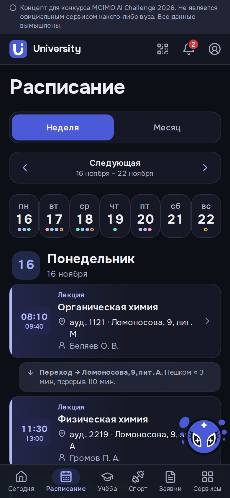
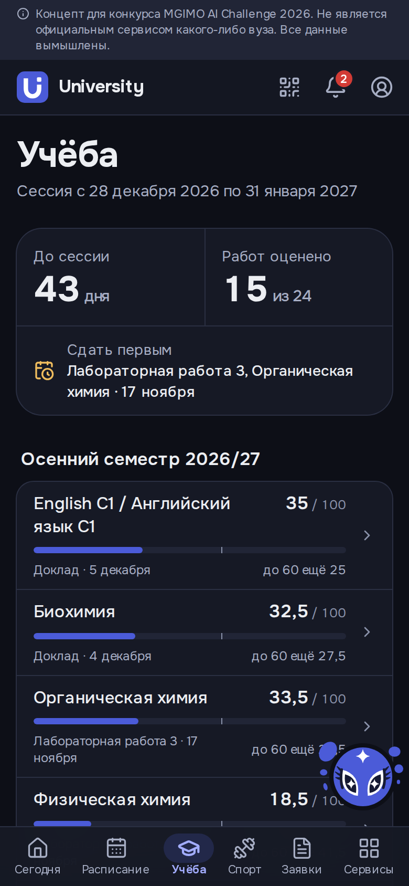
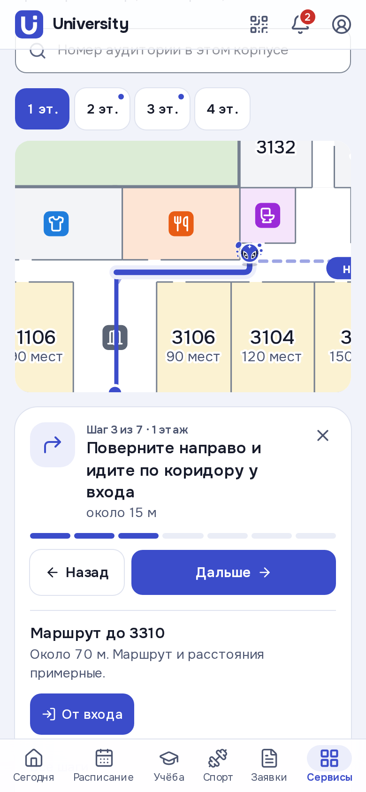
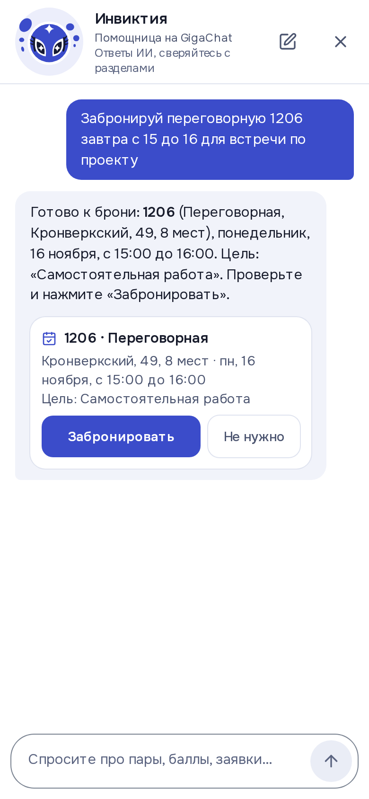

# Цифровой деканат University

Работающий прототип личного кабинета студента вымышленного университета **University** —
трек «Вайб-кодинг» конкурса [MGIMO AI Challenge 2026](https://challenge.mgimo.ai/). Код написали ИИ-агенты
(Claude Code — ведущий разработчик, Codex — ревьюер), люди ставили задачи и принимали решения.

> Концепт для конкурса MGIMO AI Challenge 2026. Не является официальным сервисом какого-либо вуза. Все данные
> вымышлены.

| | |
|---|---|
| **Сайт** | **https://university-dekanat.duckdns.org** — сервер в России, HTTPS |
| **Аккаунты** | логины ниже, пароли — в комментарии к работе |
| **Отчёт о работе с ИИ** | [`docs/submission/report.pdf`](docs/submission/report.pdf) |
| **Видео** | демонстрация 2:54 — ссылка в комментарии к работе; ролик собран кодом ([`video/`](video/README.md)) |

<p>
  
  
  
  
</p>

## Как проверить

| Логин | Кто | Что важно |
|---|---|---|
| `alina.lebedeva` | Лебедева Алина, 3 курс, группа H3301, Факультет химии и биотехнологий | основной сценарий, полный цикл заявки |
| `timur.orlov` | Орлов Тимур, 2 курс, группа P3212, Факультет программной инженерии и компьютерной техники | другие группа, оценки и заявки |
| `dekanat.fhb` | Миронова Ксения, специалист деканата ФХБ | кабинет сотрудника: двигает заявки |

1. С телефона (от 360 px) или компьютера войдите **Алиной**: «Сегодня» → «Расписание» (переносы и отмены
   помечены) → «Учёба» (баллы, контрольные точки, сессия) → «Заявки» → «Новая» → справка об обучении,
   формат «электронная».
2. Выйдите и войдите **сотрудником**: в заявке Алины «Взять в работу» → «Применить статус», затем «Отметить готовой»
   → «Применить статус».
3. Снова **Алиной**: в колокольчике уведомление, у заявки статус «Готова» и PDF справки с QR-кодом. QR открывает
   страницу проверки, которой не нужен вход.
4. Войдите **Тимуром**: свои группа, расписание и оценки. Ссылка на заявку Алины даёт «Страница не найдена» (404).

**Полный цикл заявки — Алиной.** Сотрудник `dekanat.fhb` обслуживает факультет Алины; заявки Тимура (другой факультет)
ему не видны — так задумано.

**Аккаунты общие для всех экспертов.** Пароль и логин через сайт не меняются. Квоты тоже общие: если помощница
отвечает «на этот день у вас уже есть бронь», бронь оставил предыдущий эксперт. Активную бронь можно отменить
в «Сервисы» → «Бронирование аудиторий» → «Мои брони»; если она уже закончилась, выберите другой день.

## Что внутри

- **Обязательное ядро ТЗ:** вход и профиль; расписание на день, неделю и месяц с переносами; успеваемость
  с баллами, контрольными точками и сессией; заявки и справки со статусами и историей; уведомления деканата,
  дедлайны и изменения.
- **Связанный кабинет:** пара ведёт к аудитории, корпусу, маршруту и преподавателю; баллы — к контрольным точкам;
  заявка — к истории и уведомлениям.
- **Маршрут внутри корпуса по шагам** на собственных схемах этажей, от входа или из аудитории прошлой пары.
- **Электронная справка с QR-кодом**: выпускает сотрудник, проверяет работодатель без входа.
- **Помощница Инвиктия на GigaChat** отвечает по данным студента и готовит бронь аудитории; решение
  принимает студент кнопкой.
- **Сервисы:** пропуск с QR, печать по коду, Wi-Fi, «Куда обратиться», бронь аудиторий, физкультура
  «успел — записался».
- Телефон и компьютер, светлая и тёмная тема, состояния загрузки, пустоты и ошибок, доступность (WCAG AA, axe).

## Как работали с ИИ — где смотреть

| Где | Что |
|---|---|
| [`AGENTS.md`](AGENTS.md), [`CLAUDE.md`](CLAUDE.md) | правила для агентов: безопасность, данные, интерфейс, порядок работы |
| [`docs/ai-log/JOURNAL.md`](docs/ai-log/JOURNAL.md) | журнал по шагам: промпты, решения, ошибки ИИ, проверки, ручные действия |
| [`docs/ai-log/codex/`](docs/ai-log/codex/) | ревью Codex: планы до кода, диффы после, перепроверки, аудиты |
| [`docs/plans/`](docs/plans/) | планы функций, которые проходили ревью до реализации |
| [`docs/agent-eval/`](docs/agent-eval/) | сценарии проверки помощницы и результаты прогонов |
| [`tests/integration/`](tests/integration/) | доступ студента A к данным B для каждой сущности, гонки, закрытые эндпоинты входа |
| [`docs/PRODUCT.md`](docs/PRODUCT.md), [`docs/DECISIONS.md`](docs/DECISIONS.md) | продукт, сценарии и принятые решения |

## Безопасность коротко

- Кто вы — знает только сервер по сессии. Номер объекта в адресе — лишь указатель: запрос к базе всегда ограничен
  и владельцем. Чужое — 404.
- Пароли хранятся только хешем (scrypt), регистрации нет, не больше 10 попыток входа в минуту с адреса.
  Через `/api/auth` открыты только вход, выход и проверка сессии.
- Ключи (GigaChat, секрет сессий) — только в окружении сервера, не в коде и не в браузере.
- Подробно и простыми словами — раздел 6 отчёта.

## Запуск

Нужен Node.js 24 или новее (проверено на 24.22 и 26.13).

```bash
cp .env.example .env        # заполнить: секрет Better Auth, пароль БД, пароли демо-аккаунтов
npm install
npm run db                  # PostgreSQL на 127.0.0.1, держать запущенным в отдельном терминале
npm run db:deploy           # миграции
npm run db:seed             # демо-данные: alina.lebedeva, timur.orlov, dekanat.fhb
npm run dev                 # http://127.0.0.1:3000
```

На Windows можно задать в `.env` `PG_DATA_DIR="C:/MGIMO/mgimo-digital-dekanat/.data/postgres"`,
чтобы локальная БД лежала в игнорируемом каталоге проекта. Скрипт выбирает совместимую локаль.
`typecheck` сначала генерирует типы маршрутов Next.js, поэтому работает и в свежем checkout.

Проверки: `npm run typecheck`, `npm run lint`, `npm test`, `npm run test:db`
(интеграционные тесты на отдельной БД `TEST_DATABASE_URL`, имя должно оканчиваться на `_test`).

На сервере: `docker compose up -d --build` (PostgreSQL, приложение и Caddy с HTTPS) — по шагам в
[`docs/DEPLOY.md`](docs/DEPLOY.md).

Стек: Next.js 16 · React 19 · TypeScript · Tailwind CSS 4 · PostgreSQL 18 · Prisma 7 · Better Auth · GigaChat API.

## Архив

Материалы на 11.11, до большой части работы, сохранены как история:
[`docs/NURSU-HANDOFF.md`](docs/NURSU-HANDOFF.md), [`docs/submission/pr-description.md`](docs/submission/pr-description.md),
[`docs/submission/video-script.md`](docs/submission/video-script.md) (видео в итоге собрано кодом, см. `video/`).

`.env`, пароли и скриншоты исследования (`docs/research/screenshots/`) в репозиторий не попадают.
