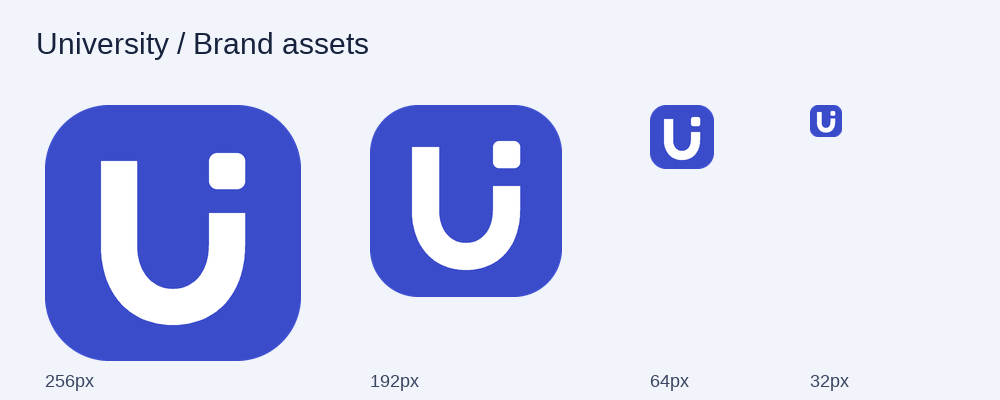

# Цифровой деканат будущего

University / MGIMO AI Challenge 2026 / трек «Вайб-кодинг»

Рабочий черновик от 11 ноября 2026 года. Не готов к отправке жюри:
нужны скриншоты развития интерфейса, результаты опроса и финальные проверки.

Команда: Детков Андрей (DetkovAndrew), капитан; NursuUwU, исследование,
контент, проверка устройств и подготовка демонстрации.

## 1. Какую проблему мы решаем

Студенту приходится искать расписание, баллы, справки и объявления в разных местах.
Даже найденная информация часто не помогает сделать следующий шаг: из расписания
непонятен переход между корпусами, из числа баллов — что сдавать дальше,
а после заказа справки — в каком состоянии обращение.

Мы создаём связанный кабинет вымышленного University. Пара ведёт к преподавателю,
корпусу и маршруту; дисциплина показывает контрольные точки и дефицит баллов;
заявка имеет историю; подтверждённая тренировка включается в расписание.
Это прототип с настоящими входом и базой данных, а не набор статичных макетов.

Гипотеза основана на опыте команды. Подтверждение небольшим опросом ещё не получено.
Анкета на 8–10 участников подготовлена в docs/research/survey.md.
Мы не приводим выдуманные ответы, выводы или цитаты студентов.

Все люди, оценки и номера в кабинете синтетические. Реальные системы вузов
не подключены. На страницах есть дисклеймер о конкурсном концепте.

---

## 2. Что есть в текущем прототипе

Вход по логину и паролю обслуживает Better Auth. Два демонстрационных студента
учатся в разных группах: Алина — H3301, третий курс ФХБ; Тимур — P3212,
второй курс программной инженерии. У сотрудника деканата отдельная роль.
Пароли не включаются в отчёт и репозиторий.

Расписание показывает день и неделю, корпуса, аудитории и преподавателей.
Переносы сохраняют историю. Из карточки можно перейти к подробностям занятия,
к преподавателю и корпусу. Маршрут открывается ссылкой в Яндекс Картах.
Оценка времени перехода приблизительная.

Успеваемость строится по контрольным точкам. Накопленные баллы отделены
от итоговой аттестации; попытки пересдач не складываются. Порог 60 баллов
и шкала — демонстрационные правила University.

Заявки включают каталог, проверяемую форму, номер, статус и историю.
Уведомления адресованы студенту: изменение занятия или заявки, объявление,
напоминание. Будущие публикации скрыты до срока.

Физкультура в этом checkout ещё использует приоритеты и жеребьёвку с проверкой
расписания и переходов. Команда планирует перейти к мгновенной записи.
Не следует описывать эту переделку как уже законченную.

ИИ-помощник пока не реализован. Для него подготовлены 30 сценариев,
включая 6 провокаций безопасности и 3 вопроса вне темы. Кабинет сотрудника
пока заглушка; управление заявками через него не готово. Выдача подписанного
PDF-документа также не реализована.

---

## 3. Как мы работали с ИИ

Claude Code по журналу проекта выступал ведущим разработчиком: создавал каркас,
схему данных, авторизацию, экраны и тесты. Codex давал второе мнение по требованиям,
архитектуре, безопасности и изменениям. В этом проходе NursuUwU явно поручил
Codex выполнить доступные задачи своей части команды.

Документы AGENTS.md и CLAUDE.md задают общие правила: сервер определяет владельца,
данные вымышлены, интерфейс русскоязычный и работает от 360 px. Решения и отклонённые
варианты записываются отдельно. Источник истории — docs/ai-log/JOURNAL.md,
полные ревью — docs/ai-log/codex/.

Ключевые постановки задач и результат:

- Разбор ТЗ: чек-лист обязательного ядра, стек, риски и дополнительные идеи.
  Сохранён исходный запрос и ответ в codex/01-tz-review.md.
- Проверка схемы и авторизации: ограничения владельца, история переносов,
  статусы заявок и допустимые результаты аттестации. codex/03-schema-auth-review.md.
- Упрощение кабинета: убрать перегрузку, сохранить понятный следующий шаг,
  проверить идею помощника и механизмы спорта. codex/09-simplify-ai-agent.md.
- Ревью раскрытия карточек: связь пары, курса, преподавателя и корпуса,
  отсутствие утечки оценок одногруппников. codex/11-drilldown-impl-review.md.
- Задачи NursuUwU: подготовка анкеты, eval, исследования хостинга, оригинального SVG,
  сценариев проверки и видео, черновика отчёта. codex/12-nursu-deliverables.md.

Подтверждённые инструменты: Claude Code, Codex; веб-поиск официальных документов;
браузер для локального осмотра; Pillow для иконок; ReportLab и Poppler для PDF.
Отдельная модель генерации картинок не использовалась. GigaChat/Qwen остаются
кандидатами для встроенного агента, а не доказанными инструментами реализации.
Команде нужно дополнить перечень фактически использованных IDE и сервисов.

---

## 4. Ошибки, проверка и исправления

ИИ предлагал переносить проект из-за проблем прав WSL. Команда отклонила перенос,
администратор исправил подключение диска. Журнал сохраняет и неудачную попытку,
и ручное решение, а не только успешный результат.

Ревью обнаруживало ошибки в смысле данных: синтетический ID тренировки нельзя
открывать как учебную пару; большое число баллов не отменяет выставленную двойку;
«зачтено» не должно соседствовать с сообщением о невозможности зачёта.
В журнале предыдущего этапа перечислены исправления и проверки.

В этом проходе обнаружены совпадения двух вымышленных имён с реальными сотрудниками
вузов. Они заменены в seed; проверка всех 21 имени и ссылки на источники сохранены
в docs/research/fictional-data-audit.md. Отсутствие результата поиска не считается
доказательством уникальности имени.

Текст seed обещал подписанную справку и PDF, которого пока нет. Формулировка исправлена;
также уточнены объявления о сессии и продлении проездного. Оставшееся обещание
«PDF с подписью» в каталоге заявок вынесено в замечания владельцу форм.

На Windows локальная база не запускалась с Unix-локалью C.UTF-8. Скрипт теперь
выбирает совместимую C, сохраняя UTF-8. Проверка типов в свежем checkout
требовала типов маршрутов: команда typecheck теперь запускает next typegen перед tsc.

Проверено 11.11: типы, линтер, 48 модульных и 25 интеграционных тестов.
Визуально осмотрен экран входа 360 px. Подробные результаты HTTP и сборки,
включая ограничения, приведены в docs/qa/local-checks.md.
Это не подтверждение полного сценария на настоящем телефоне или доступности из РФ.

---

## 5. Вход, хранение и защита простыми словами

Пароль нужен для входа; Better Auth сохраняет его хеш, а не исходную строку.
После входа сервер узнаёт пользователя по сессии. Студент не выбирает во входном
запросе свою роль, чужой профиль или право менять оценку.

Каждый запрос личных данных ограничивается владельцем из серверной сессии.
Подстановка другого номера объекта в адресе не даёт доступа: сервер отвечает 404.
Расписание выбирается через группу студента. Публичная для вошедших карточка
преподавателя не содержит чужих результатов, заявок или списков студентов.

Формы проверяются на сервере. Поля, роли и переходы статусов ограничены.
Изменения, история и соответствующие уведомления объединяются в транзакции.
Личные результаты не помещаются в общий кеш; ответы кабинета используют no-store.

Данные хранятся в PostgreSQL. Локальный embedded-postgres — настоящий PostgreSQL,
а не данные в памяти процесса. Для production запланированы Docker Compose,
постоянный том базы, Nginx и HTTPS. Поведение после перезапуска сервера нужно
подтвердить отдельным сценарием на финальном хостинге.

Секреты берутся из окружения; .env игнорируется Git. В браузер не передаются
ключи провайдеров. Для будущего агента изменяющее действие должно сначала
показывать конкретный черновик и требовать подтверждение. Отказ агента словами
не заменяет серверную проверку доступа и проверку отсутствия изменений в БД.

Не заявляем полную независимую сертификацию безопасности: в наличии исходники,
ревью и тесты конкретных сценариев, а не доказательство отсутствия любых уязвимостей.

---

## 6. Дизайн и доказательства процесса

Для University создан собственный SVG-знак: белая U с отделённым модулем
на синем фоне #3b4cca. Он подключён ко входу, навигации, favicon и manifest.
Есть версии 32/192/512 px и иконка телефона 180 px. Официальные логотипы вузов
не использовались. Предварительная идея простой U была отвергнута до экспорта.

Лист выше — артефакт дизайна, не скриншот работающего кабинета.
Снимки интерфейса не восстановлены задним числом по выдуманным макетам.
Для окончательной версии сюда нужно включить реальные изображения:

- Первоначальный экран и финальный экран того же раздела с датой/версией.
- Расписание с реальным демонстрационным переносом и переходом между корпусами.
- Дисциплина с баллами, созданная заявка и тот же номер после перезахода.
- Спорт в окончательном механизме записи; уведомление, связанное с действием.
- Настоящий телефон и ширина 360 px; второй студент с другими данными.
- Ошибка/неудачный вариант и исправление, подтверждённые журналом или сохранённым кадром.

Не добавлять в публичный Git скриншоты my.itmo, реальные переписки, пароли, cookie
или ключи. Материалы должны содержать только синтетические данные прототипа.
Точный перечень кадров и шагов — docs/qa/mobile-checklist.md и video-script.md.

---

## 7. Ручные этапы и готовность к сдаче

По существующему журналу люди выбрали трек и вымышленный University, отклонили
перенос проекта, исправляли окружение, задавали приоритеты и принимали решения
по упрощению интерфейса. Это подтверждённые ручные этапы прошлой работы команды.

В текущем проходе материалы подготовил Codex. Ещё не выполнены людьми:
опрос 8–10 студентов и согласованные цитаты; проверка домашнего/мобильного интернета;
финальный проход на Android/iPhone; принятие знака; запись видео и отправка работы.
Не записываем подготовку ИИ как ручной этап участника.

План до сдачи:

- До 14.11: провести опрос, заполнить результаты; после готовности агента выполнить 30 сценариев.
- До 15.11: капитан выбирает VPS после итоговой котировки и проверки UK-варианта.
- До 17.11: принять знак и уточнить спорные совпадения обычных имён.
- 18–19.11: реальные телефоны, основной сценарий обоих студентов, проверка сохранности.
- До 20.11: исправить блокирующие ошибки, закончить развёртывание, собрать доказательства.
- 20–21.11: заменить этот черновик финальным отчётом со скриншотами; при желании видео до 5 минут.
- До 22.11 23:59 МСК: капитан отправляет ссылку, тестовые учётки, исходники и отчёт.

Пароли передаются жюри только в комментарии к работе. Прототип должен открываться
из РФ без VPN и работать до 28.11.2026 включительно. Публикация и оплата в этом
проходе не выполнялись. Черновик основан на ТЗ, PRODUCT.md, TEAM.md и журнале ИИ;
список конкретных оставшихся действий находится в docs/NURSU-HANDOFF.md.
